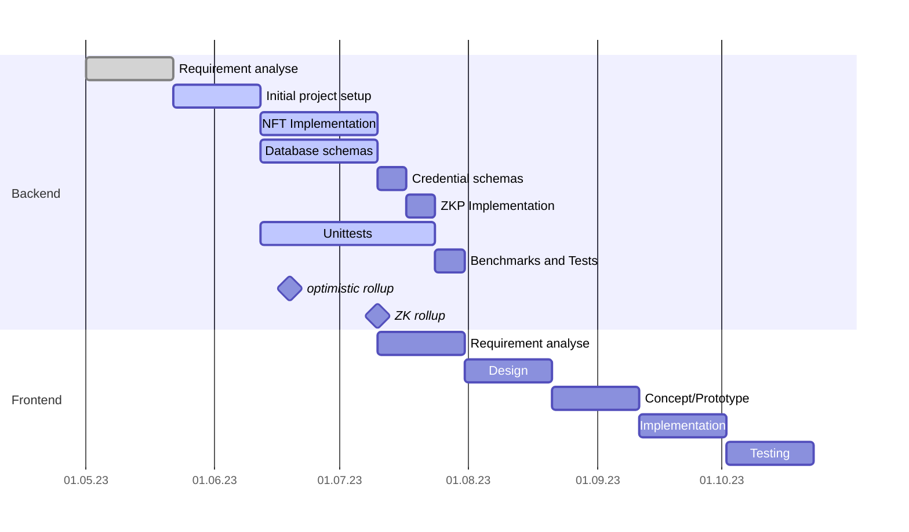

# SFNFTs 

## Getting started
[//]: <> (TODO: Readme Zusammenfassung)

***

## Name
Shielded Fractional NFTs

## Description
In this project, the idea of "Shielded Fractional NFTs" originally presented by Matthias Babel et al. in
["Enabling end-to-end digital carbon emission tracing with shielded NFTs"](https://doi.org/10.1186/s42162-022-00199-3)
is implemented. 

This prototype is part of the research project [ID-Ideal](https://id-ideal.de/about/)
In this project, a simpler and more secure management of digital identities is explored. 
The focus is on the broad application of the developed solution in various sectors.
In this prototype, the possibility of using NFTs, SSI and ZKPs for the creation, verifiability and 
traceability of electricity certificates.
In addition, the mapping of CO2 emissions from energy production to consumption for the realization of
a CO2 footprint of individual persons will be made possible.

The technologies used are intended to facilitate participation in electricity markets and lead toward a 
real-time energy economy with end-to-end interconnection.
They also enable fine-grained, traceable recording of CO2 emissions without violating privacy.
Which is necessary, among other things, for effective climate protection.

The NFTs represent labeling certificates on the blockchain, which serves as a transaction register and 
highly available infrastructure.
Fractional NFTs are used to subdivide and pass on the performance specified in the certificates by 
dividing NFTs into "smaller" certificates.
These labeling certificates are to be reliably created with the help of SSI.
NFTs guarantee privacy and prevent double-counting. For this purpose, invalidated NFTs (nullifiers) and 
ownerships are stored with Merkletrees.
They enable an anonymous ("shielded") transaction of the NFTs.
The use of Merkletrees excludes the possibility of tracing back former ownerships.

## Installation
[//]: <> (TODO: IDE Setup)

## Test and Deploy
[//]: <> (TODO: Zusammenfassung der Test-Wikipage und zum Compilen)

## Usage
[//]: <> (TODO: Zusammenfassung der Verwendung, ggf. Troubleshooting)

## Contributing

If you want to contribute to this project, please make sure you familiarize yourself with our 
[wiki](https://gitlab.fit.fraunhofer.de/pgwi/blockchainlab/sfnfts/-/wikis/home), 
**especially the coding and git guidelines**, and apply them.

As questions arise that are not covered by the wiki, please update the wiki accordingly for the next new 
developer.

***

## Roadmap

## Authors and acknowledgment

Original idea by Matthias Babel et al.: 
["Enabling end-to-end digital carbon emission tracing with shielded NFTs"](https://doi.org/10.1186/s42162-022-00199-3)

Backend design and implementation: Claus Guthmann, Henrik Laubert

## License
[//]: <> (TODO: Welche Lizenz ist zu nutzen?)
