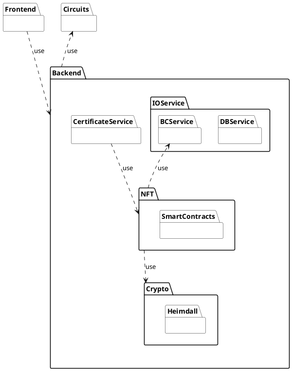
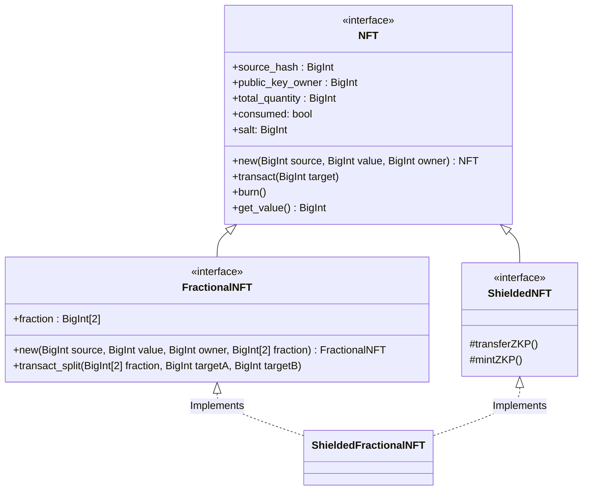
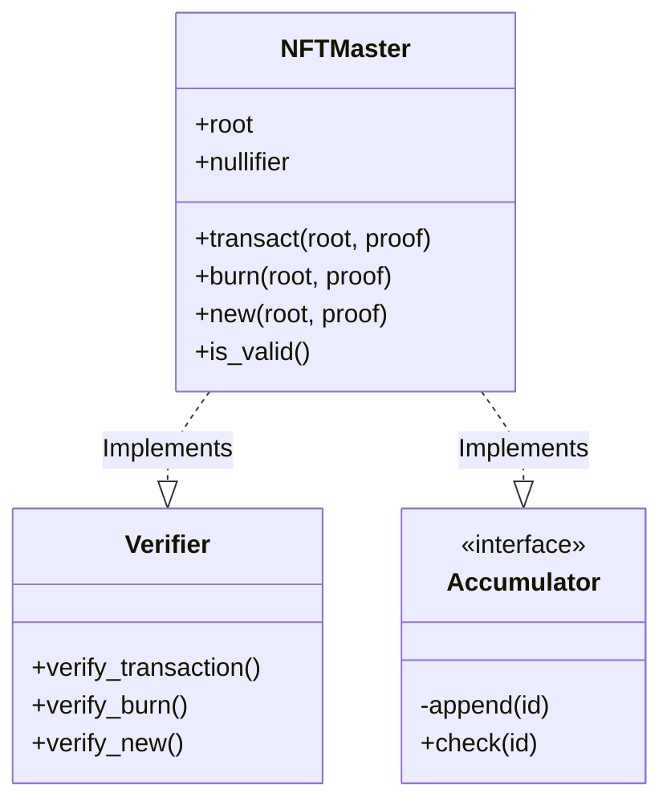
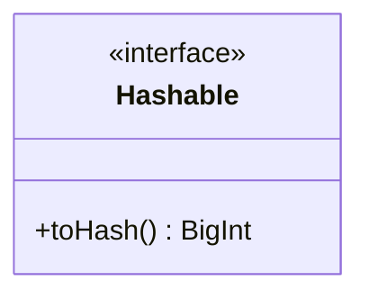
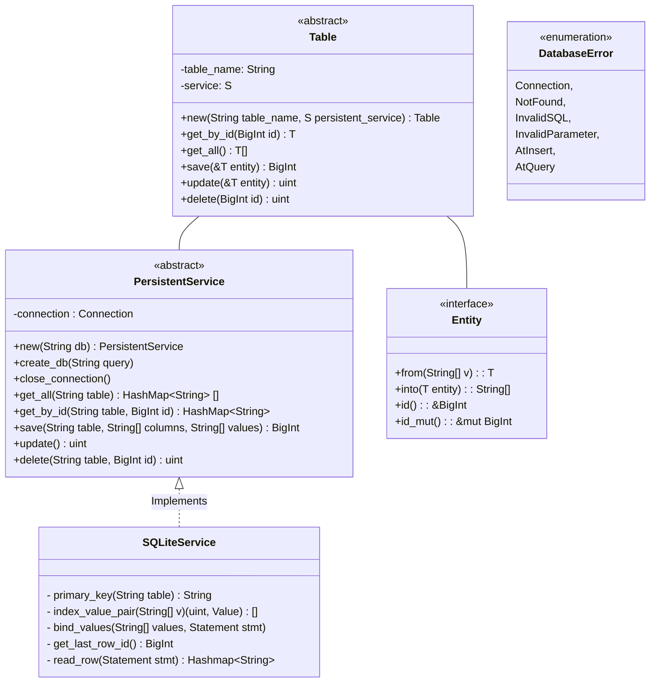
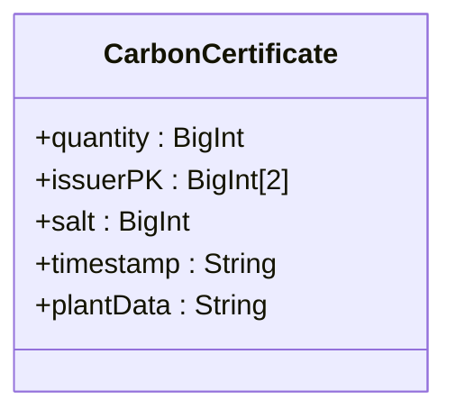
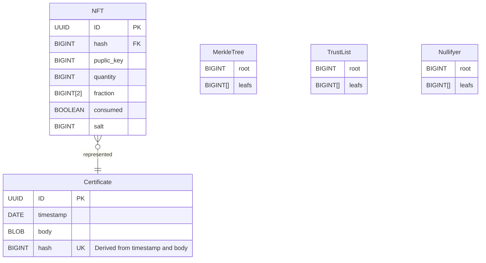
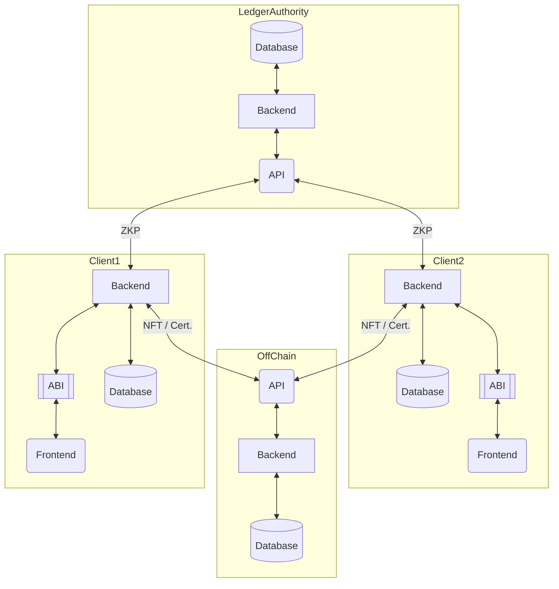
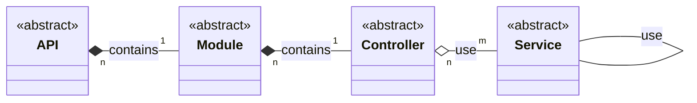

# Overview of the architecture

## Packages
The following graphics give a short overview of all packages in the project. The illustrations will be
updated continuously during the course of the project, as the Mermaid plugin used is still under
development and cannot yet map all dependencies.

The frontend package is a second application since it has to be written in Java for mobile apps
and thus cannot be deployed with the backend, which is written in Rust.
The same applies to the Circuits package since its ZKPs are written in Solidity.
The certificate service, BCservice, and DBservice contain standard interfaces, so arbitrary
implementations for certificates, blockchains, and databases can be used.



### The NFT package

The NFT package contains three interfaces: ordinary NFTs, fractional NFTs, and shielded NFTs.
In this way, any type of NFTs could be implemented.



### The SmartContracts Package

A single, smart contract (NFTMaster) manages all transactions. The verifier can be used to verify past 
transactions. The accumulator is used to store the transactions on the blockchain.



### The Crypto Package

The interface Hashable represents a clean abstraction of all objects that should be explicitly hashable 
and therefore implement a toHash method comparable to the toString method.



### The DBService Package

See the [Database](#database) section for more information.


### The CertificateService Package

Certificates are created using the Heimdall framework and the two ZKPs of the Circuits package.
In addition, they must implement the Hashable and ShieldedFractionalNFT interfaces.
(Corresponding representation with mermaid follows)



### The Circuits Package

The Circuits package contains the two ZKPs necessary to prove that NFTs have been correctly created or 
transferred.


## Database

As this is just a small prototype to give a proof of concept, we avoided handling a full Client-Server
based database system by using SQLite[^1].

Think of SQLite not as a replacement for a full SQL Database but as a replacement for `fopen()`.
Since the database consists of a single file, no server is running that hosts an Interface for
interaction with the database.

All actions related to the database take place inside the Rust code, using the _sqlite_ crate[^2].
The queries are simple SQL strings that are passed to the according library functions.

SQLite is not the perfect choice for applications with a large amount of data (that's transferred over a
network) and many concurrent writers. Because of that, it also may be necessary to move on to a
full Client-Server based database system if the use case of this prototype grows.

We have chosen SQLite as the SQL-based interface, as this makes it easier to implement the future changes
described above.

### Quirks, Caveats, and Gotchas In SQLite

Some special cases need to be considered while working with SQLite:[^3]
1. SQLite Is Embedded, Not Client-Server
2. Flexible Typing
   - No Separate BOOLEAN Datatype
   - No Separate DATETIME Datatype
   - The data type is optional
3. Foreign Key Enforcement Is Off By Default
4. PRIMARY KEYs Can Sometimes Contain NULLs
5. Aggregate Queries Can Contain Non-Aggregate Result Columns That Are Not In The GROUP BY Clause
6. Does Not Do Full Unicode Case Folding By Default
7. Double-quoted String Literals Are Accepted
8. Keywords Can Often Be Used As Identifiers
9. Dubious SQL Is Allowed Without Any Error Or Warning
10. AUTOINCREMENT Does Not Work The Same As MySQL
11. NUL Characters Are Allowed In Text Strings
12. SQLite Distinguishes Between Integer And Text Literals

### Relational model

SQLite only knows `NULL`, `INTEGER`, `REAL`, `TEXT`, and `BLOB`.
This means the actual implementation deviates from the model, which was deliberately kept database
agnostic.

Important Mappings are:

| data type | SQLite representation    |
|-----------|--------------------------|
| `UUID`    | `INTEGER` / `TEXT`       |
| `BOOLEAN` | `INTEGER`                |
| `BIGINT`  | `TEXT`                   |
| `DATE`    | `TEXT`                   |
| `ARRAY`   | `BLOB` / multiple fields |



### Object Relational Mapping (ORM) and Repository Pattern

We are using the _ORM pattern_. In summary, this means that every class of objects that needs to be stored
maps to a corresponding table in our DB.

On top, we apply a _repository pattern_ that abstracts the interaction for each class and table.
Wherefore the Table-Interface contains all functions that can be applied to the data of a table.
E.g. `get_by_id()`, `insert()` or `delete()`. This decouples the classes completely from the database
because the class only has to implement the entity interface if you want to be able to store them.
The Table-Interface corresponds to a function repository of the repository pattern.

**To map a new class to the database, you need to take care of the following steps:**
1. Create the corresponding table.
   You can do so by adding a `CREATE TABLE` statement inside the `create_databse.sql` file.
2. Implement the Entity-Interface for the class you want to save.
3. Instantiate a persistent service and a new Table in your code.
   ```
   let service = db_service::SQLiteService::new(db_path, "sfnft".to_string());
   let table = db_service::Table::new(table_name, service);
   ```
   1. It may be necessary to extend the interface or the persistent service if you're introducing a
      new query function.
4. Now, you can use the Table instance to store or load instances of the new class.
   ```
   let id = table.save(instance_of_your_class)?;
   let instance_of_your_class = table.get_by_id(id)?;
   ```

Under the hood, the table makes use of a so-called
persistent service. Such a service handles the communication between repositories (tables) and the database.
While, in general, you won't find any SQL code in repositories (tables), a persistent service implements the
specific SQL queries. So **if the underlying database architecture is changed**, it is only
necessary to implement the persistent service interface for this new architecture. The repositories (tables) are
generic concerning the used persistent service, so they don't need to be reimplemented.

## Network

The following figure gives an overview of the structure of the network.
Each node runs in its own Docker container (Except SQLite databases, as these are serverless).

The backends are each Rust crates built from the project workspace, according to the feature set.

The APIs provide all necessary functions for communication with the Ledger Authority or other clients.
Any communication that does not have to take place on the chain is explicitly separated from the Ledger
Authority.

As a general interface for frontends in any language, the client backend provides an **application binary interface
(ABI)** to integrate the code into other languages. For more information, see the
[Frontend Development](#Frontend-Development) section.

The client databases store NFTs and certificates. The Ledger Authority database stores the Merkle trees
for the shielded NFTs, trust list, and Nullifyer.

The off-chain database stores messages to enable asynchronous communication between the clients.
If this is not necessary, peer-to-peer communication can replace this part.




### APIs

The APIs are implemented using the [rocket crate](https://rocket.rs/).  
APIs consist out of consist out modules (don't confuse this with _rust modules_) that hold **controllers** that handle
the **endpoints** (or **routes**) for one major group of provided
HTTP requests. (**Routes** are annotated functions in the controller that call the according functions in the services.)

**Controllers** take care of building the final reply and enforcing rules on permissions and authentication.
**For the sake of security, be very aware of the
data you return from endpoints and the management of permissions who can interact with these endpoints.**
Controllers use so-called **services** (or **providers**) for all other functionality.

You can think about controllers as extended interfaces. **Services** would be the implementation of such an interface.
Services are separated from controllers because they most likely will contain functions that other services could use. 
Since **we don't want to send HTTP requests to use a specific function of our own API** (including permission
handling and authentication), we separate those functions in separate files (rust modules).
The [documentation of NestJS](https://docs.nestjs.com/) provides general guidance for this idea.

In most cases, it should be enough to encapsulate the controllers and services in separate modules.
However, if constructors and temporary storing data (in struct fields) become necessary, implementing structs
and traits might be necessary.



**Since Rocket does not enforce such a structure, the developer must implement it manually.**
Because of this, please make sure to follow this structure when introducing a new module:
```
api_root
├── src
│   ├── some_module
│   │   ├── some_controller.rs
│  ...  ├── some_service.rs
│   │   └── some_dto.rs
│   └── main.rs
...
```
(the `_controller`, `_service`, and `_dto` prefixes are ment to be used)

- The `main.rs` file imports all modules and contains the launch function for rust, which binds the routes for each
  controller.
```
#[launch]
fn rocket() -> _ { /*...*/ }
```

- `mod.rs` files **reexport** all controllers of the module as well as all services you want to use in other modules.
```
pub mod some_controller; // reexport all controllers
pub mod some_service; // reexport services
```

- `*_controller.rs` files import their used services from `mod.rs` and implement routes.
You may also want to define the `BASE`-Route of the controller here.
```
use super::some_service;
pub const BASE: &str = "/";
```

### Data Transfer Object (DTO)

DTO is a pattern to handle data transfer between separated systems with unique data representations.
A DTO is used to encapsulate data and send it from one subsystem of an application to another.
In our case, this is done by parsing the data into a JSON format and sending JSON-Strings through the network.

Each DTO contains clearly defined fields with defined data types.
API endpoints should always return DTOs and only accept data that matches a specified DTO.

This increases security as invalid and malicious requests can be detected and filtered more easily.
Furthermore, the code quality is significantly increased by clearly defined interfaces and type definitions.
Because of the explicit specification of DTOs and which endpoints accept which DTOs, DTOs can be quickly and error-free
converted into corresponding rust structs, which can then be passed on to the services and processed.

The use of DTOs also allows the user of the API to choose his language so that he does not necessarily have to
work with rust.

## Frontend Development

One of the requirements for the backend was to make it possible to write a graphical user interface (frontend), another
(almost any) language. To archive this, we had to separate the backend from the frontend using the
[Foreign Function Interface (FFI)](#Foreign-Function-Interface-FFI) to C libraries provided by rust and
deploy the backend as a _dynamic system library_.

Additionally, this solution enables a cross-platform solution for different operating systems and devices.

### Foreign Function Interface (FFI)

A **foreign function interface (FFI)** is a mechanism by which a program written in one programming language can call
routines or make use of services written or compiled in another one.

The primary function of a foreign function interface is to mate the semantics and calling conventions of one programming
language (the _host_ language or the language which defines the FFI) with the semantics and conventions of another
(the _guest_ language). This process must also consider both the runtime environments and
[application binary interfaces](#Application-Binary-Interface-ABI).

### Application Binary Interface (ABI)

An **application binary interface (ABI)** is an interface between two binary program modules. Often, one of these
modules is a library or operating system facility, and the other is a program run by a user.

An _ABI_ defines how data structures or computational routines are accessed in machine code, a low-level,
hardware-dependent format. In contrast, an _API_ defines this access in source code.

### Write and build a library for FFI

Dangerously summarized: Any struct or function annotated in the following manner that respects all the characteristics
of data representation and processing over an ABI can be wrapped into a library and used outside of rust. Don't be
fooled, especially the "characteristics" part can be tricky, depending on the languages that should be supported.
More detailed explanations and hints on what to watch out for can be found under the listed sources in the
[Further reading](#Further-reading) section.
```
#[repr(C)]
struct my_struct { /* ... */ }

#[no_mangle]
pub extern "C" fn call_from_outside() { /* ... */ }
```

To compile the library for your system, you have to compile the crate using the `crate-type attribute` by adding the
`--crate-type=cdylib` flag to your compiler command or add the `#![crate_type = "cdylib"]` macro to the crate source.

### Calling Rust Functions from Other Languages

As it may happen in the future that other functions than the ones provided by us are needed, or it is not directly clear 
how they could be used in other languages, we describe a minimal working example here. You can use it as a guideline 
together with the existing code to extend the library.

#### Minimal Rust library

The following two files build a minimal working example for a dynamic library written in rust. Because of the 
`crate-type` attribute inside the `Cargo.toml` file you can compile this lib simply by using `cargo build`.

- `Cargo.toml`
```
[package]
name = "example_lib"
version = "0.1.0"
edition = "2021"

[dependencies]
/* ... */

[lib]
crate-type = ["dylib"]
```
- `src/lib.rs`
```
#[no_mangle]
pub extern "C" fn add(left: usize, right: usize) -> usize {
    left + right
}
```

#### JavaScript

In JS all you need to execute functions from the library **inside a node.js environment** is the 
[`ffi-napi` package](https://www.npmjs.com/package/ffi-napi/v/4.0.3). You can install using:
```
npm install ffi-napi
```
To import the library use the package and link the functions using the `Library()` function.
The arguments are the path to the library (you can omit the `.so` or `.dll` prefix) and a dictionary of all functions
you want to use. Use the function names as keys, the values is an array of the return type and a nested array of the 
parameter types.
```javascript
const ffi = require('ffi-napi');
const lib = ffi.Library('example_lib', {add: ['int', ['int', 'int']]});

console.log("Add: " + lib.add(2,5));
```

### Java

Java supports the usage of native libraries in its language core. all you have to do is to load the library and define 
the signatures of the functions you want to use.
```java
class Test {
    statix {
        System.loadLibrary("example_lib");
    }

    native int add(int a, int b);

    public static void main(String args[]) {
        System.out.println("Add: " + new Test().add(2, 3));
    }
}
```

- To compile this you can simply run 
```
javac Test.java
```

- Since `System.loadLibrary()` takes the **library name as parameter not the path** you might have to run it using the 
`LD_LIBRARY_PATH` environment variable to provide the path to the library on runtime.
```
LD_LIBRARY_PATH=. java Test
```
 
### Python 

In Python, you can import libraries using the `ctypes` package. But unlike in JS you don't need to link the functions by 
hand. You can call them as methods of the imported library object.
```
from ctypes import *

lib = cdll.LoadLibrary("./libffi.so")
print("Add: " + str(lib.add(2,5)))
```

### C

The usage in C is very similar to Java, with the difference that you link the library at compile time.
```
#include <stdio.h>

extern unsigned add(unsigned a, unsigned b);

int main() {
    printf("add: %d\n", add(2,2));
    return 0;
}
```

Link the library using the `-l` flag like this and provide the path using the `-L` flag:
```
gcc example.c - o example -lexample_library -L<path>
```

You can execute the program using the `LD_LIBRARY_PATH` environment variable
```
LD_LIBRARY_PATH=. ./example 
```

### We are sorry!

To build the FFI library, we had to consider sources such as the Rust Book Chapter about _"Unsafe Rust"_ and
_The Rustonomicon_[^4], which describes itself as the documentation that _"digs into all the awful details that you
need to understand when writing Unsafe Rust programs."_ and teaches you "_The Dark Arts of Unsafe Rust_"...

So - just to be safe - we want to apologize in advance if this code might cause severe suffering and has a negative 
impact on your coding experience.

**Believe us, we tried our very best!**

### Further reading

- The Rust Reference: [Chapter 14 "Linkage"](https://doc.rust-lang.org/reference/linkage.html)
- The Rust Programming Language: [Chapter 19.1 "Unsafe Rust"](https://doc.rust-lang.org/book/ch19-01-unsafe-rust.html#using-extern-functions-to-call-external-code)
- Rust By Example: [Chapter 20.8 "Foreign Function Interface"](https://doc.rust-lang.org/rust-by-example/std_misc/ffi.html?highlight=FFI#foreign-function-interface)
- The Rustonomicon: [Chapter 11 "Foreign Function Interface"](https://doc.rust-lang.org/nomicon/ffi.html)

***

[^1]: [SQLite](https://www.sqlite.org/)
[^2]: [sqlite crate](https://docs.rs/sqlite/latest/sqlite/index.html)
[^3]: [Quirks of SQLite](https://www.sqlite.org/quirks.html)
[^4]: [The Rustonomicon](https://doc.rust-lang.org/nomicon/intro.html)
