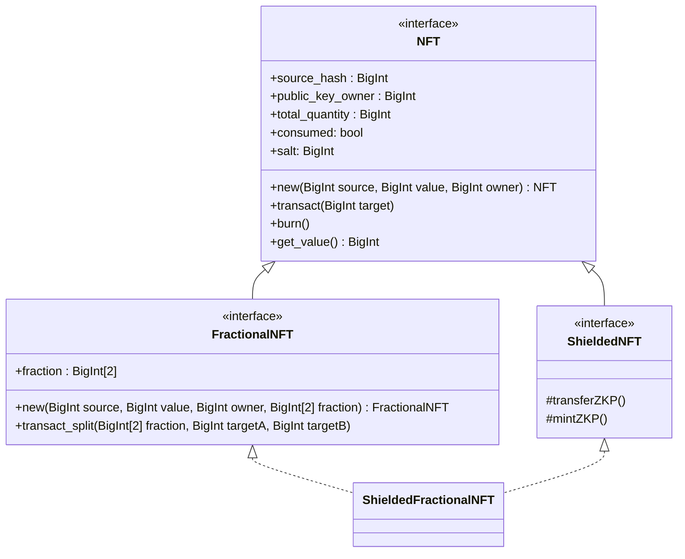
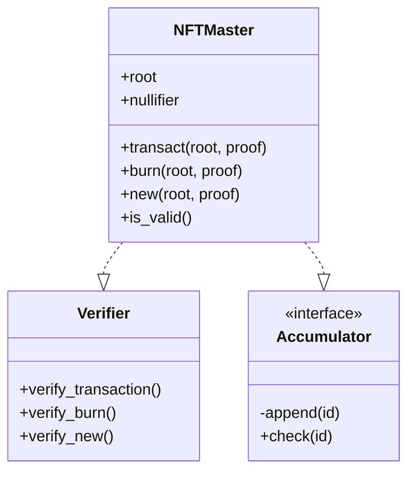
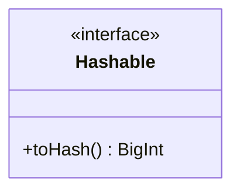
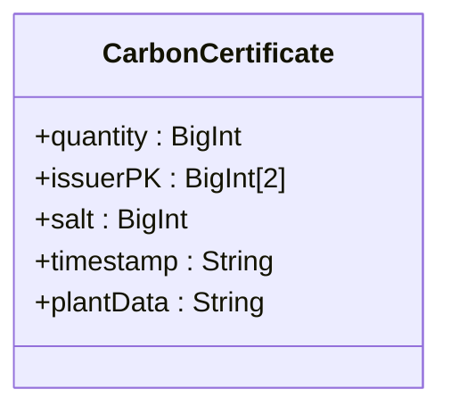
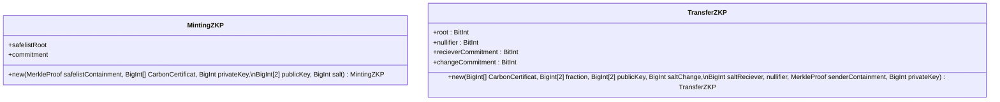

# Overview of architecture

## Packages
The following graphics give a short overview of all packages of the project. The illustrations will be
updated continuously during the course of the project, as the Mermaid plugin used is still under
development and cannot yet map all dependencies.

In fact, the frontend package is a second application, since it has to be written in Java for mobile apps 
and thus cannot be deployed together with the backend, which is written in Rust.
The same applies to the Circuits package, since the ZKPs it contains are written in Solidity.
The certificate service, BCservice and DBservice contain common interfaces so that arbitrary 
implementations for certificates, blockchains and database can be used.

### The NFT package

The NFT package contains three interfaces: ordinary NFTs, fractional NFTs, and shielded NFTs.
In this way, any type of NFTs could be implemented.

### The SmartContracts Package

A single smart contract (NFTMaster) manages all transactions. The verifier can be used to verify past 
transactions. The accumulator is used to store the transactions on the blockchain.

### The Crypto Package

The interface Hashable represents a clean abstraction of all objects that should be explicitly hashable 
and therefore implement a toHash method, comparable to the toString method.

### The CertificateService Package

Certificates are created using the Heimdall framework and use the two ZKPs of the Circuits package.
In addition, they must implement the Hashable and ShieldedFractionalNFT interfaces.
(corresponding representation with mermaid follows)

### The Circuits Package

The Circuits package contains the two ZKPs necessary to prove that NFTs have been correctly created or 
transferred.

## Database

As this is just a small prototype to give a proof of concept we avoided to handle a full Client-Server 
based database system by using SQLite[^1]. 

Think of SQLite not as a replacement for a full SQL Database but as a replacement for `fopen()`.
Since the Database consists of a single file and there is no server running that hosts an Interface for
interaction with the Database.

All actions related to the database take place inside the Rust code, using the _sqlite_ crate[^2].
The queries are simple SQL-strings that passed to the according library functions.

Right now we are storing the Data in JSON-formatted BLOBs, since we only need this Database to
permanently store our data, produced during runtime, in a consistent way.
But this may change if the interaction with the stored data becomes more complex and require the data,
stored in the BLOBs, to become accessible for queries.

SQLite is not the perfect choice for applications with large amount of data (that's transferred over a
network) and many concurrent writers. Because of that it also may be necessary later on to move on to a
full Client-Server based database system if the use case of this prototype grows.

We have chosen SQLite as the SQL-based interface, as this makes it easier to implement the future changes
described above.

### Quirks, Caveats, and Gotchas In SQLite[^3]

There are some special cases that need to be considered while working with SQLite:
1. SQLite Is Embedded, Not Client-Server
2. Flexible Typing
   - No Separate BOOLEAN Datatype
   - No Separate DATETIME Datatype
   - The datatype is optional
3. Foreign Key Enforcement Is Off By Default
4. PRIMARY KEYs Can Sometimes Contain NULLs
5. Aggregate Queries Can Contain Non-Aggregate Result Columns That Are Not In The GROUP BY Clause
6. Does Not Do Full Unicode Case Folding By Default
7. Double-quoted String Literals Are Accepted
8. Keywords Can Often Be Used As Identifiers
9. Dubious SQL Is Allowed Without Any Error Or Warning
10. AUTOINCREMENT Does Not Work The Same As MySQL
11. NUL Characters Are Allowed In Text Strings
12. SQLite Distinguishes Between Integer And Text Literals

### Relational model

tbd.

***

[^1]: [SQLite](https://www.sqlite.org/)
[^2]: [sqlite crate](https://docs.rs/sqlite/latest/sqlite/)
[^3]: [Quirks of SQLite](https://www.sqlite.org/quirks.html)
