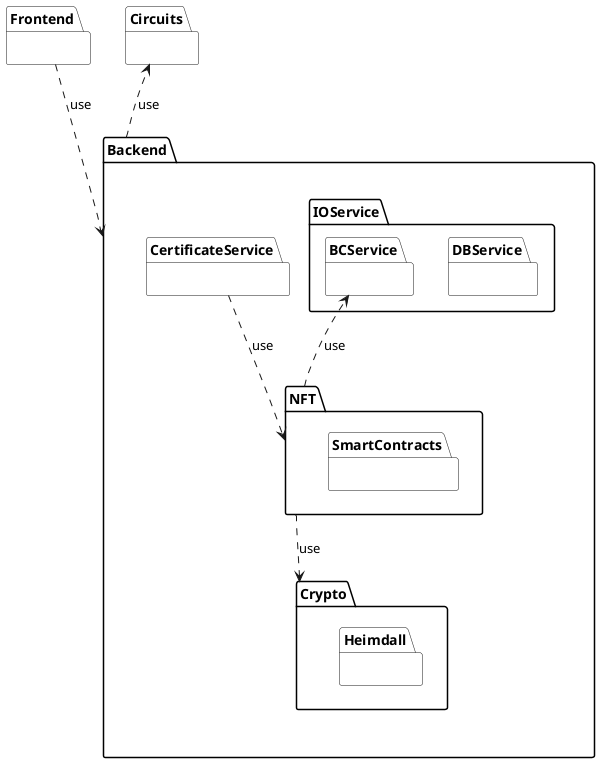
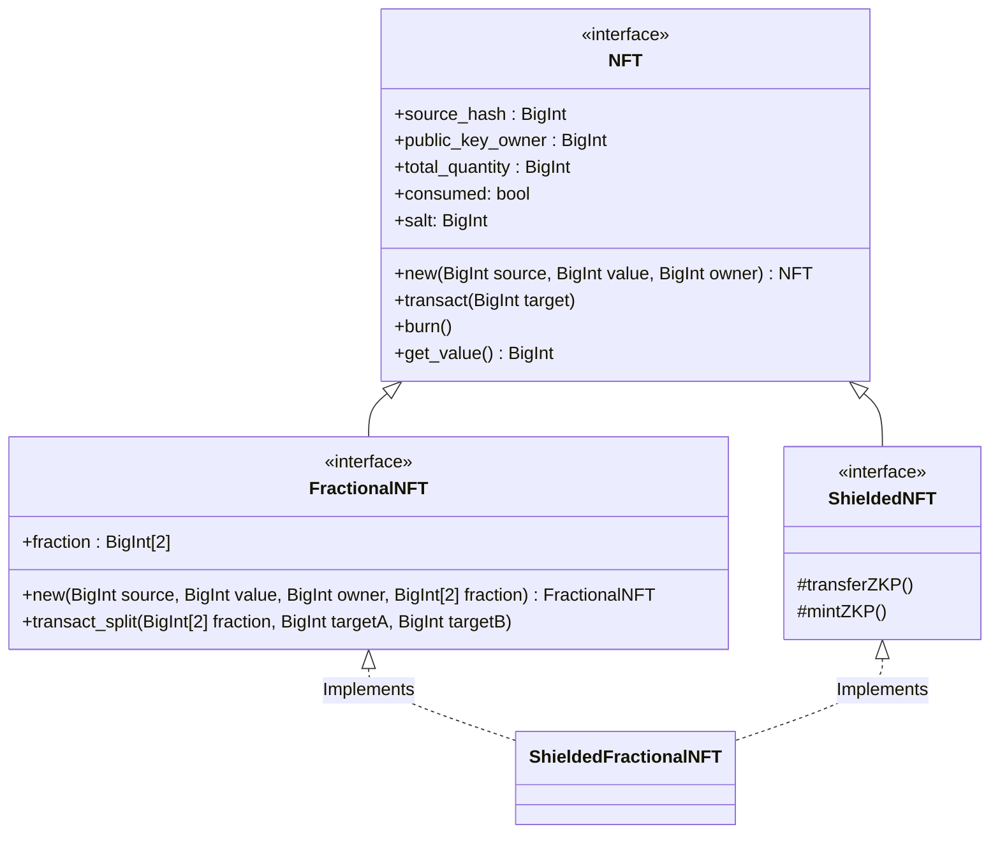
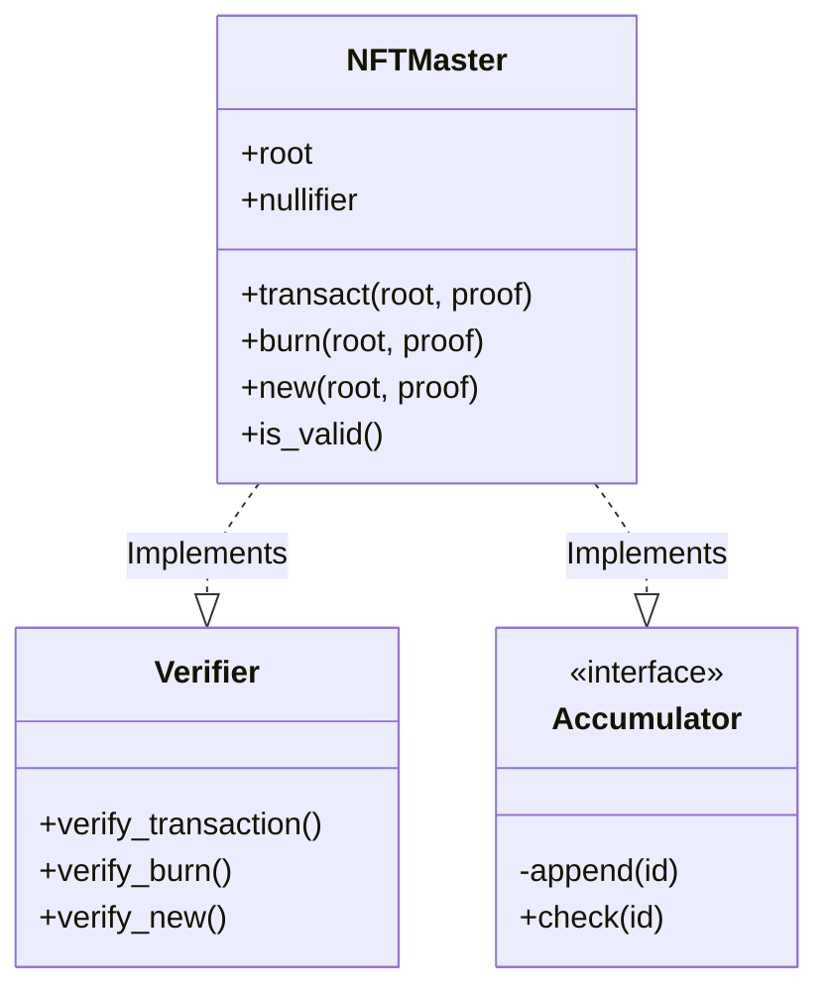
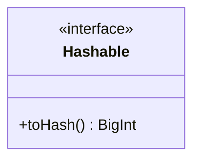
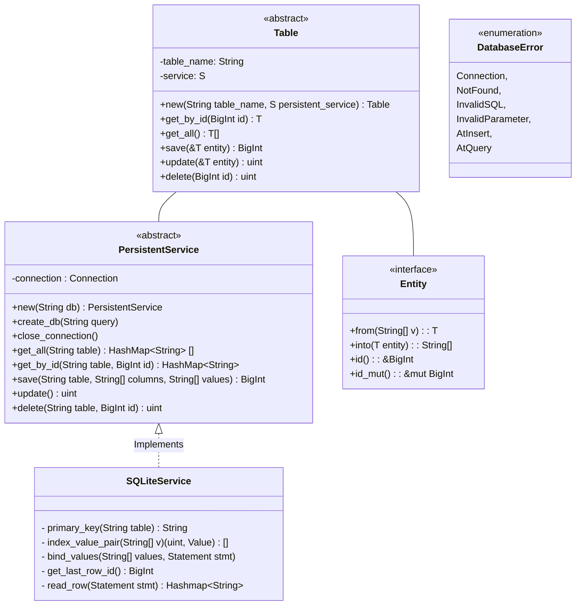
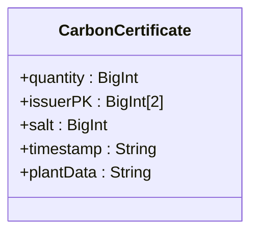
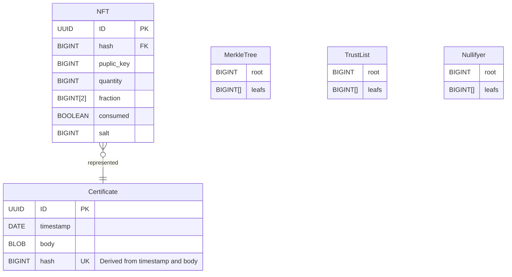
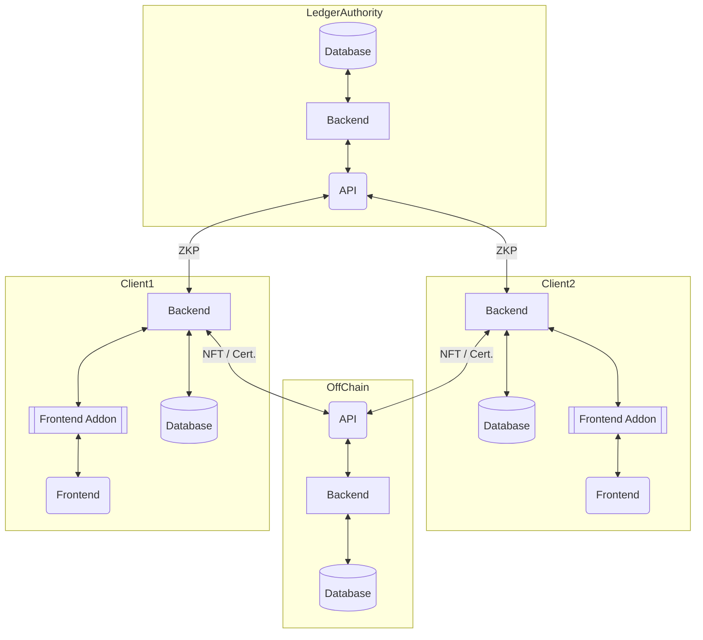
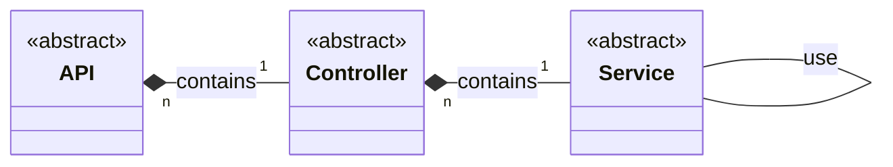

# Overview of architecture

## Packages
The following graphics give a short overview of all packages in the project. The illustrations will be
updated continuously during the course of the project, as the Mermaid plugin used is still under
development and cannot yet map all dependencies.

In fact, the frontend package is a second application, since it has to be written in Java for mobile apps 
and thus cannot be deployed together with the backend, which is written in Rust.
The same applies to the Circuits package, since the ZKPs it contains are written in Solidity.
The certificate service, BCservice, and DBservice contain common interfaces so that arbitrary 
implementations for certificates, blockchains, and databases can be used.



### The NFT package

The NFT package contains three interfaces: ordinary NFTs, fractional NFTs, and shielded NFTs.
In this way, any type of NFTs could be implemented.



### The SmartContracts Package

A single smart contract (NFTMaster) manages all transactions. The verifier can be used to verify past 
transactions. The accumulator is used to store the transactions on the blockchain.



### The Crypto Package

The interface Hashable represents a clean abstraction of all objects that should be explicitly hashable 
and therefore implement a toHash method, comparable to the toString method.



### The DBService Package

For more information see the [Database](#database) section.


### The CertificateService Package

Certificates are created using the Heimdall framework and use the two ZKPs of the Circuits package.
In addition, they must implement the Hashable and ShieldedFractionalNFT interfaces.
(Corresponding representation with mermaid follows)



### The Circuits Package

The Circuits package contains the two ZKPs necessary to prove that NFTs have been correctly created or 
transferred.


## Database

As this is just a small prototype to give a proof of concept, we avoided handling a full Client-Server 
based database system by using SQLite[^1]. 

Think of SQLite not as a replacement for a full SQL Database but as a replacement for `fopen()`.
Since the Database consists of a single file and there is no server running that hosts an Interface for
interaction with the Database.

All actions related to the database take place inside the Rust code, using the _sqlite_ crate[^2].
The queries are simple SQL-strings that passed to the according library functions.

SQLite is not the perfect choice for applications with a large amount of data (that's transferred over a
network) and many concurrent writers. Because of that, it also may be necessary later on to move on to a
full Client-Server based database system if the use case of this prototype grows.

We have chosen SQLite as the SQL-based interface, as this makes it easier to implement the future changes
described above.

### Quirks, Caveats, and Gotchas In SQLite

There are some special cases that need to be considered while working with SQLite:[^3]
1. SQLite Is Embedded, Not Client-Server
2. Flexible Typing
   - No Separate BOOLEAN Datatype
   - No Separate DATETIME Datatype
   - The datatype is optional
3. Foreign Key Enforcement Is Off By Default
4. PRIMARY KEYs Can Sometimes Contain NULLs
5. Aggregate Queries Can Contain Non-Aggregate Result Columns That Are Not In The GROUP BY Clause
6. Does Not Do Full Unicode Case Folding By Default
7. Double-quoted String Literals Are Accepted
8. Keywords Can Often Be Used As Identifiers
9. Dubious SQL Is Allowed Without Any Error Or Warning
10. AUTOINCREMENT Does Not Work The Same As MySQL
11. NUL Characters Are Allowed In Text Strings
12. SQLite Distinguishes Between Integer And Text Literals

### Relational model

Note that SQLite only knows `NULL`, `INTEGER`, `REAL`, `TEXT` and `BLOB`.
This means that the actual implementation deviates from the model, which was deliberately kept database 
agnostic.

Important Mappings are:

| data type | SQLite representation    |
|-----------|--------------------------|
| `UUID`    | `INTEGER` / `TEXT`       |
| `BOOLEAN` | `INTEGER`                |
| `BIGINT`  | `TEXT`                   |
| `DATE`    | `TEXT`                   |
| `ARRAY`   | `BLOB` / multiple fields |



### Object Relational Mapping (ORM) and Repository Pattern

We are using the _ORM pattern_. In summary, this means that every class of objects that need to be stored
maps to a corresponding table in our DB. 

On top, we apply a _repository pattern_ that abstracts the interaction for each class and table.
Wherefore the Table-Interface contains all functions that can be applied to the data of a table.
E.g. `get_by_id()`, `insert()` or `delete()`. This decouples the classes completely from the database,
because the class only have to implement the entity interface if you want to be able to store them.
The Table-Interface corresponds to a function repository of the repository pattern.

**To map a new class to the database, you need to take care of the following steps:**
1. Create the corresponding table.
   You can do so by adding a `CREATE TABLE` statement inside the `create_databse.sql` file.
2. Implement the Entity-Interface for the class you want to save.
3. Instantiate a persistent service and a new Table in your code.
   ```
   let service = db_service::SQLiteService::new(db_path, "sfnft".to_string());
   let table = db_service::Table::new(table_name, service);
   ```
   1. It may be necessary to extend the interface or the persistent service if you're introducing a
      new query function.
4. Now you can use the Table instance to store or load instances of the new class.
   ```
   let id = table.save(instance_of_your_class)?;
   let instance_of_your_class = table.get_by_id(id)?;
   ```

Under the hood, the table makes use of a so-called 
persistent service. Such a service takes care of the communication between repositories (tables) and the database.
While, in general, you won't find and SQL code in repositories (tables) a persistent service implements the 
specific SQL queries. So **in the case that the underlying database architecture is changed** it is only
necessary to implement the persistent service interface for this new architecture. The repositories (tables) are
generic with regard to the used persistent service, so they don't need to be re-implemented.

## Network

The following figure gives an overview of the structure of the network.
Each node runs in its own Docker container (Except SQLite databases, as these are serverless).

The backends are each Rust crates built from the project workspace, according to the feature set.

The APIs provide all necessary functions for the communication with the Ledger Authority or other clients. 
Any communication that does not have to take place on chain is explicitly separated from the Ledger 
Authority.

As a general interface for frontends in any language, the client backend provides an addon to integrate 
the code into other languages.

The client databases store NFTs and certificates, the Ledger Authority database stores the Merkle trees 
for the shielded NFTs, trust list and Nullifyer.

The off chain database stores messages between to enable asynchronous communication.
If this is not necessary, this part can be replaced by peer to peer communication.



### APIs

The APIs are implemented using the [rocket crate](https://rocket.rs/).  
APIs consist out of **controllers** that handle the **endpoints** (or **routes**) for one major group of provided 
HTTP requests.

**Controllers** take care of building the final reply and enforcing rules on permissions and authentication.
**For sake of security and since rocket does not provide advanced technologies to handle this, be very aware about the 
data you return from endpoints, as well of as of the management of permissions who can interact with these endpoints.**
For all other functionality controllers make use of so-called **services** (or **providers**).

You can think about controllers as extended interfaces. **Services** would be the implementation of such an interface.
Services are seperated from controllers because they most likely will contain functions that could be used from other 
services. Since **we don't want to send HTTP requests to use a specific function of our own API** (including permission 
handling and authentication) we separate those functions in separate modules.
The [documentation of NestJS](https://docs.nestjs.com/) provide general guidance for this idea.

**Routes** are annotated functions in the controller that call the according functions in the services. 

In most of the cases it should be enough to encapsulate the controllers and services in separate modules.
However, if constructors and temporary storing data (in struct fields) becomes necessary an implementation using structs 
and traits might be necessary.



### Data Transfer Object (DTO)

DTO is a pattern to handle data transfer between seperated systems with unique data representations.
A DTO is used to encapsulate data, and send it from one subsystem of an application to another.
In our case this is done by parsing the data to into a JSON format and send JSON-Strings through the network. 

Each DTO contains clearly defined fields with defined data types.
API endpoints should always return DTOs and only accept data that matches a specified DTO.

This increases security as invalid and malicious requests can be detected and filtered more easily.
Furthermore, the code quality is significantly increased by clearly defined interfaces and type definitions.
Because of the clear specification of DTOs and which endpoints accept which DTOs, DTOs can be easily and error-free 
converted into corresponding rust structs, which can then be passed on to the services and be processed.

The use of DTOs also allows the user of the API to choose his own language, so that he does not necessarily have to 
work with rust.
***

[^1]: [SQLite](https://www.sqlite.org/)
[^2]: [sqlite crate](https://docs.rs/sqlite/latest/sqlite/index.html)
[^3]: [Quirks of SQLite](https://www.sqlite.org/quirks.html)
